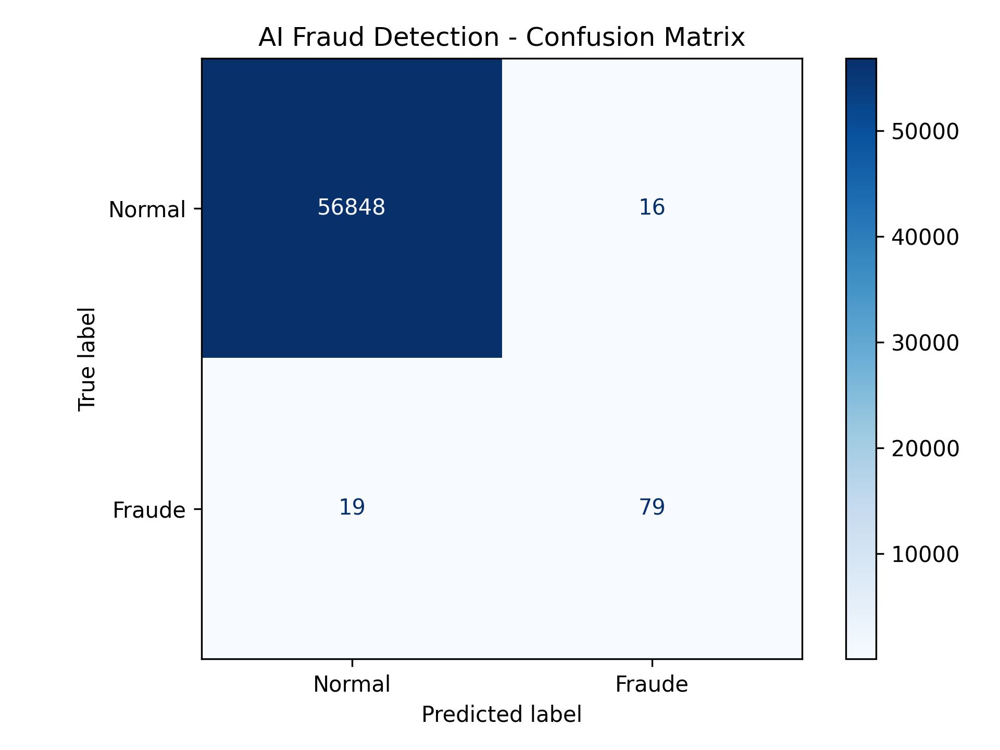

# AI Fraud Detection System

Machine Learning project for detecting fraudulent credit card transactions using Python and Random Forest.

## Project Overview

This project explores credit card fraud detection using a real-world anonymized dataset containing 284,807 transactions, including 492 fraudulent transactions.

The objective is to train and evaluate a machine learning model capable of identifying potentially fraudulent transactions.

## Technologies

- Python
- Pandas
- NumPy
- Scikit-learn
- Matplotlib
- Random Forest
- Google Colab

## Dataset

**Source:** [Credit Card Fraud Detection — Kaggle](https://www.kaggle.com/datasets/mlg-ulb/creditcardfraud)

The dataset contains anonymized credit card transactions with highly imbalanced classes.

## Methodology

1. Load and inspect the dataset.
2. Separate features and target labels.
3. Split the dataset into training (80%) and testing (20%) sets using stratified sampling.
4. Train a Random Forest classifier with balanced class weights.
5. Evaluate performance using precision, recall, F1-score and Average Precision.
6. Visualize the confusion matrix.

## Model Performance

| Metric | Fraud Class |
|---|---|
| Precision | 0.83 |
| Recall | 0.81 |
| F1-score | 0.82 |
| Average Precision (PR-AUC summary) | 0.832 |

### Confusion Matrix

| | Predicted Normal | Predicted Fraud |
|---|---:|---:|
| Actual Normal | 56,848 | 16 |
| Actual Fraud | 19 | 79 |

The model correctly identified 79 out of 98 fraudulent transactions in the test set.

## Limitations

This is an educational machine learning project, not a production-ready fraud detection system.

The evaluation uses a random train/test split rather than a chronological validation strategy. Further validation, probability calibration and threshold optimization would be necessary before considering real-world deployment.

## Future Improvements

- Hyperparameter optimization
- Precision-recall curve analysis
- Decision threshold tuning
- Model explainability
- Deployment through an API

## Author

Matheus Miller

Machine Learning | Artificial Intelligence | Python
